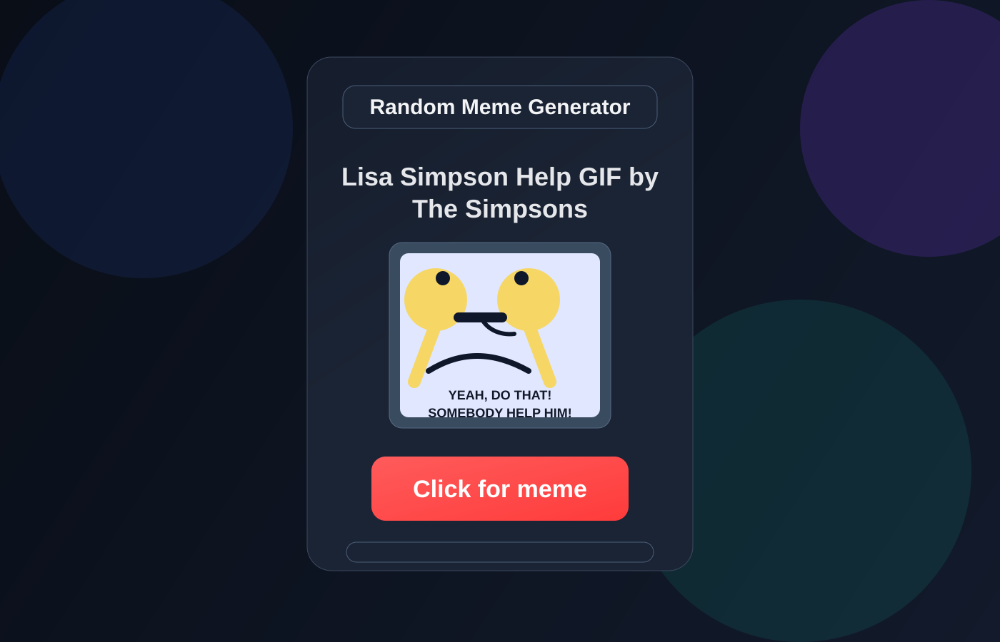

# Random Meme Generator

<p align="center">
  <a href="https://randommeme-generator.vercel.app/" target="_blank">
    
  </a>
</p>

<p align="center">
  
  
  
  
</p>

<p align="center">
  
</p>

A fun and modern meme generator built with React and Vite that fetches meme content from the Giphy API. The app lets users generate random memes with a single click and also search for memes by keyword, creating a clean and memorable user experience with responsive styling.

## Live Demo

See it in action here: https://randommeme-generator.vercel.app/

## Why this project stands out

- Clean and modern UI design
- Real API integration with Giphy
- Random meme generation in one click
- Search functionality for custom meme discovery
- Responsive layout for desktop and mobile users
- Strong demonstration of frontend interaction and state management

## Features

- Random meme generation
- Meme search by keyword
- Loading and error handling
- Responsive card-based layout
- Real-time API-driven content updates
- lightweight and fast React app experience

## Tech Stack

- React
- Vite
- JavaScript
- Tailwind CSS
- Giphy API

## How it works

1. User clicks the “Click for meme” button.
2. The app calls the Giphy API for a random meme.
3. The meme is displayed with a title and image.
4. The search field allows users to find memes by topic or keyword.
5. The UI updates instantly based on the fetched results.

## Screenshots

<div align="center">
  
</div>

## Getting Started

### 1. Clone the repository

```bash
git clone https://github.com/Sahil485661/random-meme-generator.git
cd random-meme-generator
```

### 2. Install dependencies

```bash
npm install
```

### 3. Add your environment variable

Create a `.env` file in the root directory and add your Giphy API key:

```bash
VITE_API_KEY=your_giphy_api_key_here
```

### 4. Run the app

```bash
npm run dev
```

Then open the local URL shown in the terminal, usually:

```bash
http://localhost:5173
```

## Project Structure

```bash
random-meme-generator/
├── public/
│   └── project-preview.svg
├── src/
│   ├── components/
│   │   ├── Random.jsx
│   │   └── SearchMeme.jsx
│   ├── App.jsx
│   ├── App.css
│   ├── index.css
│   └── main.jsx
├── package.json
├── vite.config.js
├── index.html
├── README.md
├── .gitignore
└── .env.example
```

## Future Enhancements

- Add meme categories or tags
- Save favorite memes
- Add share / download options
- Improve animation and transitions
- Add a dark mode toggle

## Connect with the creator

- GitHub: https://github.com/Sahil485661
- Live Demo: https://randommeme-generator.vercel.app/

## Summary

This project is a strong example of frontend development, API integration, and responsive UI design. It demonstrates practical React skills in a fun, portfolio-friendly project that is easy to understand and visually engaging for recruiters and collaborators.
